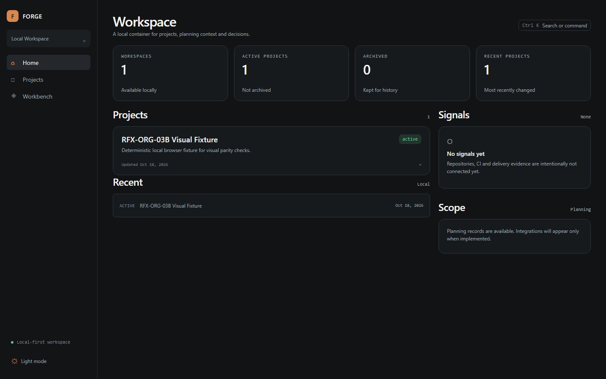
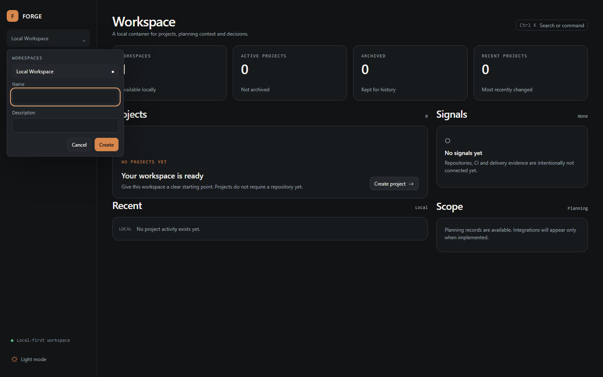
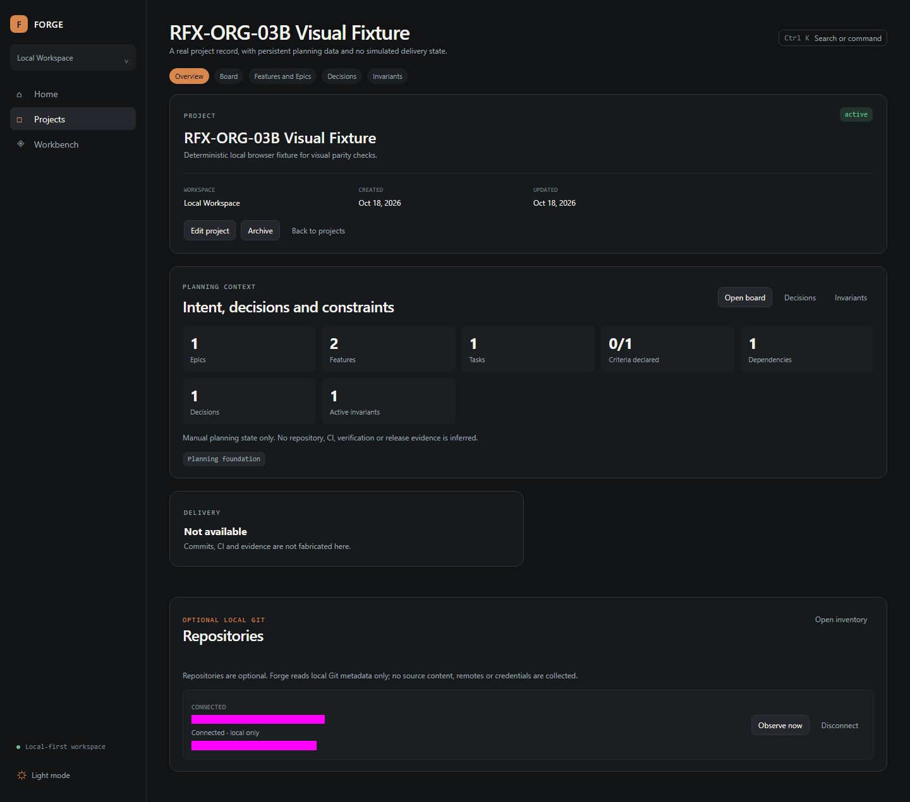
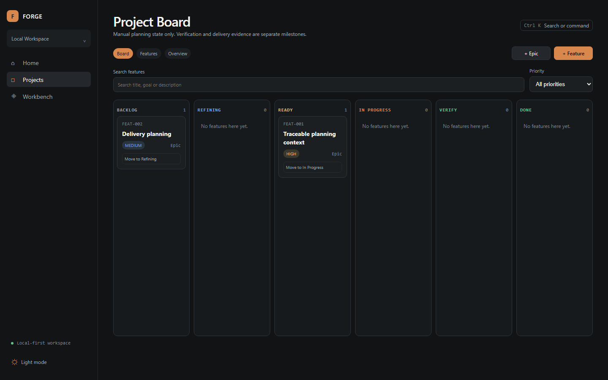
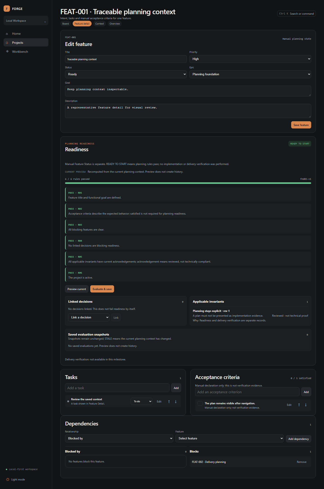
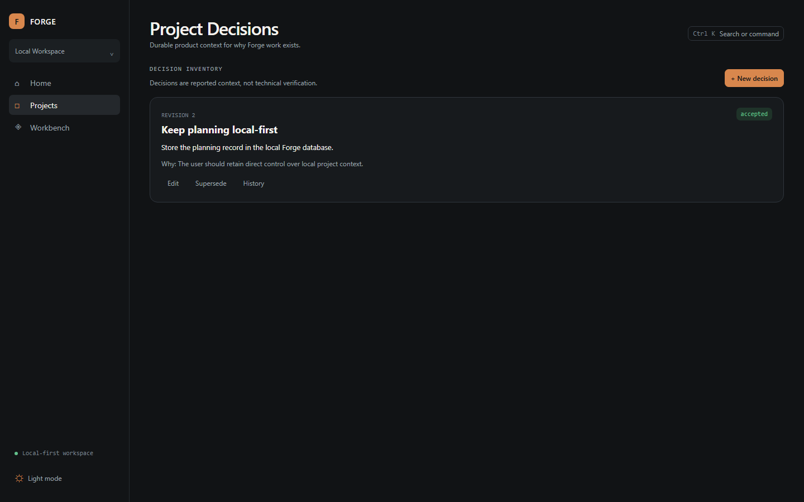
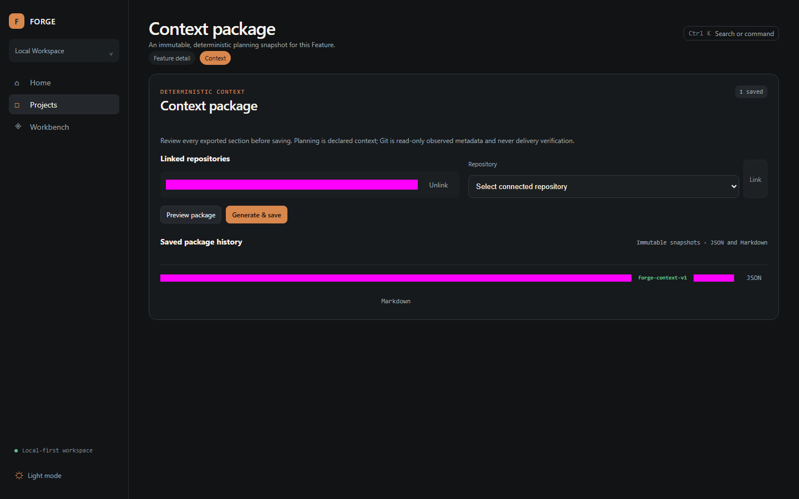
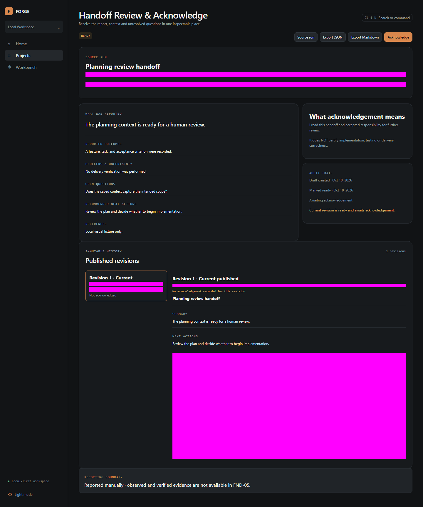
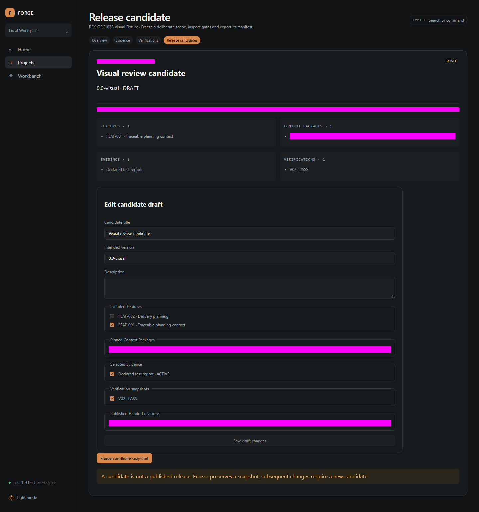

# Manual de Forge

Esta guía describe Forge Desktop Alpha tal como está implementado. Los nombres de botones y pantallas se conservan en inglés porque son los que aparecen en la aplicación.

## Qué es Forge

Forge es un espacio local-first para organizar la intención de producto, la planeación, el contexto de repositorios locales y la evidencia declarada de un proyecto de software. Úsalo cuando necesites que el equipo pueda consultar por qué se planificó algo, qué reglas aplican y qué información fue registrada antes de comenzar o entregar trabajo.

Forge no ejecuta agentes, pruebas, CI, despliegues ni comandos Git. Registra información que las personas agregan o que Forge observa de forma local y explícita.

## Instalación de Forge Desktop en Windows

Usa el instalador para Windows x64 proporcionado por tu organización. Ejecútalo para instalar Forge por usuario; no requiere elevar permisos para su ruta normal. Al abrirse, Forge inicia su backend local de forma automática.

1. Cierra una instancia anterior de Forge si está abierta.
2. Ejecuta el archivo `Forge-...-setup.exe` recibido de una fuente autorizada.
3. Sigue el asistente y abre **Forge** desde el menú Inicio.
4. Espera a que aparezca **Workspace**. La primera apertura puede tardar mientras Forge prepara sus datos locales.

El instalador actual no está firmado. Confirma el origen y checksum entregados por tu organización antes de instalarlo. Forge funciona sólo en el equipo local; no abre un servicio de red para otros equipos.

## Primer inicio y recorrido de la interfaz

La barra lateral contiene **Home**, **Projects** y **Workbench**. El selector superior izquierdo indica el Workspace activo. La cabecera de cada pantalla muestra el nombre y un botón **Search or command**.

En el primer inicio encontrarás un Workspace local vacío. Crea un Workspace antes de crear proyectos. Para abrir el formulario, selecciona el nombre del Workspace y después **Create workspace**.

Resultado esperado: el nuevo Workspace queda seleccionado y la página **Workspace** muestra su estado inicial. Si el nombre está vacío, Forge muestra el error **Workspace name is required.**

## Workspaces

Un Workspace agrupa Projects independientes. Úsalo para separar clientes, productos o áreas de trabajo.

1. Selecciona el botón del Workspace activo en la barra lateral.
2. Elige un Workspace existente para cambiarlo, o selecciona **Create workspace**.
3. Escribe **Name** y, si ayuda a tu equipo, **Description**.
4. Selecciona **Create**.

El cambio se guarda en el navegador y los Projects visibles se actualizan para el Workspace elegido. Un Workspace no comparte Projects con otro Workspace.

## Projects

Un Project es el registro durable de un producto o iniciativa. Para crear uno, abre **Projects**, selecciona **New project**, captura **Project name** y **Project description**, y elige **Create project**.

En **Project overview** puedes usar **Edit project** para cambiar nombre o descripción. Usa **Archive** cuando el Project ya no deba aceptar cambios; confirma el diálogo. Un Project archivado sigue siendo consultable. Selecciona **Restore** para permitir nuevas mutaciones otra vez.

No uses Archive como borrado: Forge conserva el historial. Las operaciones de planeación que intenten escribir en un Project archivado se rechazan.

## Epics, Features y Tasks

Abre **Open board** o la pestaña **Features** desde el Project. **+ Epic** crea un contenedor de planeación; **+ Feature** crea una unidad de intención implementable. Una Feature puede tener objetivo, prioridad, estado y Epic asociado.

En el detalle de una Feature agrega Tasks con el campo **New task** y el botón **Add**. Cada Task se puede editar, mover y pasar a estados de planeación. Estos estados son declaraciones manuales; no prueban que exista código ni entrega.

Para crear un Epic o Feature desde teclado, abre **Search or command** con `Ctrl+K`, busca la acción y completa el formulario que se abre en la ruta correspondiente.

## Project Board y transiciones de estado

**Project Board** muestra Features por estado. Usa las acciones de cada tarjeta para cambiar el estado permitido. El Board organiza la planeación, no es evidencia de implementación.

1. Ve a **Project Board**.
2. Crea o abre una Feature.
3. Selecciona el cambio de estado disponible en la tarjeta o edita la Feature.
4. Vuelve al Board para confirmar la columna nueva.

Puedes filtrar la lista **Features & Epics** con **Search features** y **Feature priority**. Si no hay coincidencias, aparece **No features exist yet. Create the first planning record.**; cambia o borra los filtros para volver a ver los registros.

## Acceptance Criteria y dependencias

En el detalle de una Feature, captura un criterio en **New acceptance criterion** y selecciona **Add**. Puedes editarlo, moverlo y marcarlo como satisfecho. La marca es una declaración manual: Forge muestra que no es evidencia de verificación.

Para relacionar Features, selecciona una relación en **Dependency relationship**, una Feature en **Dependency feature** y presiona **Add dependency**. Forge evita ciclos. Si una dependencia bloquea la Feature, el panel **Blocked by** explica el vínculo.

## Decisions e Invariants

Usa **Decisions** para documentar una elección relevante. Crea una con **+ New decision**, captura contexto, decisión y justificación; después selecciona **Accept decision** cuando la revisión sea la que el equipo aprueba. Las correcciones crean revisiones: acepta la revisión actual, no una anterior.

Usa **Invariants** para condiciones que deben seguir siendo explícitas. Crea una con **+ New invariant**, escribe **Statement** y **Rationale**, y vincúlala a un Project o Feature según aplique. Una edición aumenta la revisión y requiere reconocimiento de la nueva versión cuando la Feature la evalúa.

## Readiness

El panel **Readiness** de la Feature explica si la planeación está lista para comenzar. **Preview current** calcula el estado actual sin guardar historial; **Evaluate & save** guarda un snapshot inmutable. **READY TO START** significa sólo que las reglas de planeación configuradas se cumplen; no significa que haya código, pruebas o verificación técnica.

Para resolver bloqueos, agrega criterios, revisa dependencias, acepta Decisions y reconoce las Invariants aplicables con **Acknowledge review**. Si cambia una entrada relevante, un snapshot anterior aparece como **STALE** y debes revisarlo de nuevo.

## Conexiones de repositorios Git

Abre **Repositories** en un Project para conectar un árbol de trabajo Git local. Escribe la ruta en **Local repository path** y selecciona **Connect local repo**. Después usa **Observe now** para registrar metadatos de lectura.

Forge no modifica el repositorio conectado: no hace commit, push, checkout ni ejecuta acciones remotas. La ruta debe pertenecer a una raíz local autorizada por el operador. Si no lo está, Forge rechaza la conexión y no crea un registro. Un Project archivado mantiene la lectura histórica pero no admite nuevas observaciones.

## Context Packages

En una Feature, abre **Context package**. Selecciona un repositorio conectado, usa **Link**, y elige **Preview package** para inspeccionar la información sin escribir historial. **Generate & save** guarda un paquete inmutable y deduplicado cuando los inputs no cambian.

Puedes abrir **Tasks & criteria**, **Git observations** y **Provenance & limits** para entender qué se incluyó. Los enlaces **Download JSON** y **Download Markdown** exportan la revisión almacenada. No incluyas secretos en datos de planeación o rutas de repositorio.

## Workbench: Runs y Handoffs

**Workbench** conserva Runs declarados por personas. Para registrar uno, abre **Agent Runs**, selecciona **Record a New Run**, escoge el Project y Feature, completa **Run title** y **Executor label**, y usa **Record run**. Forge no inicia ni controla al agente indicado.

En el detalle de Run puedes agregar eventos y outputs declarados. Para preparar un reporte, usa **Prepare handoff**. Un Handoff necesita título, **summary** y **next_actions** significativos antes de **Mark ready**. Cuando esté listo, se publica una revisión inmutable que puede descargarse como JSON o Markdown.

Quien recibe el Handoff abre la revisión actual y selecciona **Acknowledge**. Si cambió la revisión, Forge no reconoce automáticamente una que la persona no vio; recarga y confirma la revisión vigente.

## Evidence y Verifications

En **Delivery**, abre **Evidence** para registrar evidencia declarada. Usa **Register evidence** y describe fuente, resultado y proveniencia con precisión. Un registro **REPORTED** no implica que Forge haya ejecutado ni validado el sistema externo.

En **Verification center** configura o consulta reglas deterministas sobre snapshots de Forge. Un resultado **PASS** prueba sólo la regla indicada y los inputs guardados. Los cambios relevantes pueden volver un resultado **STALE**.

## Release Candidates y gates

Una Release Candidate agrupa Features, Context Packages, evidencia y verificaciones. Crea una desde **Release candidates**, completa título y versión prevista, y usa **Freeze candidate snapshot**. Después, **Evaluate release gates** muestra condiciones bloqueadas o satisfechas con explicación.

**READY BY DEFINED GATES** no publica nada y no prueba por sí solo una entrega funcional. **Generate & save manifest** genera un manifiesto local con estado **NOT PUBLISHED**; los enlaces de exportación sólo descargan ese registro.

## Búsqueda, atajos y temas visuales

Selecciona **Search or command** o presiona `Ctrl+K` para abrir la Command Palette. Escribe para filtrar acciones, usa flechas arriba/abajo y `Enter` para ejecutar una navegación local. `Esc` cierra la paleta y regresa el foco al botón que la abrió.

El botón de tema cambia entre **Dark mode** y **Light mode**. La preferencia se conserva localmente. La interfaz está diseñada para escritorio y tiene una vista compacta en móvil; el Board puede desplazarse horizontalmente porque conserva columnas de planeación legibles.

## Exports

Forge permite descargar Context Packages, revisiones de Handoff y manifiestos de Release Candidate en JSON o Markdown mediante sus enlaces **Download** o **Export**. Estas descargas contienen el snapshot seleccionado; no son publicación, despliegue ni sincronización cloud.

Antes de compartir un export, revisa rutas locales, títulos, referencias y datos declarados. Forge no elimina secretos que una persona haya escrito en esos campos.

## Datos locales, respaldos y recuperación

La aplicación Desktop guarda SQLite, logs y respaldos de migración en `%LOCALAPPDATA%\Forge`. Los datos sobreviven reinicios y reinstalaciones normales del producto. No copies una base mientras Forge está escribiendo: primero cierra la aplicación y conserva una copia fechada de la carpeta de datos.

Si una actualización falla, conserva la carpeta antes de reinstalar y consulta el log local. La migración de datos se ejecuta al iniciar el producto empaquetado. Para el entorno de desarrollo, consulta [la guía de desarrollo](../development.md).

## Solución de problemas

| Situación | Qué hacer |
| --- | --- |
| No aparece un Project | Confirma el Workspace activo y abre **Projects**. Los Projects de otro Workspace no se muestran. |
| No puedes crear o editar | Revisa si el Project está **archived**; usa **Restore** si el equipo autorizó reanudarlo. |
| La conexión de repositorio falla | Verifica que sea un repositorio Git local bajo una raíz autorizada. Forge no acepta rutas arbitrarias. |
| Readiness está STALE | Revisa cambios de criterios, dependencias, Decisions o Invariants y guarda una evaluación nueva. |
| No puedes marcar un Handoff READY | Completa título, **summary** y **next_actions** con contenido no vacío. |
| Un gate no pasa | Abre la explicación del gate; registra o actualiza sólo la evidencia/verificación requerida. No declares éxito por una condición no evaluada. |

## Glosario y limitaciones conocidas

- **Workspace:** contenedor local de Projects aislados.
- **Project:** registro durable de una iniciativa; puede archivarse y restaurarse.
- **Feature:** unidad de intención con objetivo, criterios, Tasks y dependencias.
- **Context Package:** snapshot inmutable del contexto de una Feature.
- **Run:** registro declarado de trabajo; no una ejecución iniciada por Forge.
- **Handoff:** reporte versionado y reconocible para transferencia de contexto.
- **Evidence:** información reportada o observada con proveniencia explícita.
- **Verification:** evaluación determinista de una regla sobre inputs guardados.
- **Release Candidate:** snapshot local con gates explicables, nunca una publicación automática.

Limitaciones actuales: Forge es local-first, sin cuentas, multiusuario, sincronización cloud, proveedor LLM, GitHub, ejecución de CI o despliegues. Git es opcional y sólo se observa de manera local y de lectura. La validación instalada de Desktop se mantiene mediante Windows UI Automation; esta guía no habilita depuración remota del WebView.
